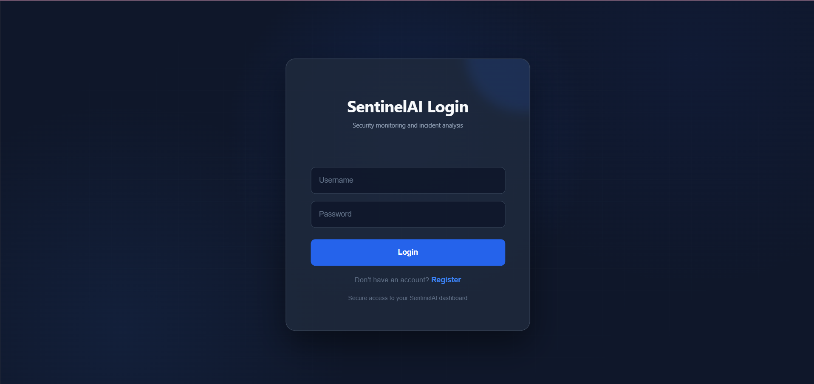
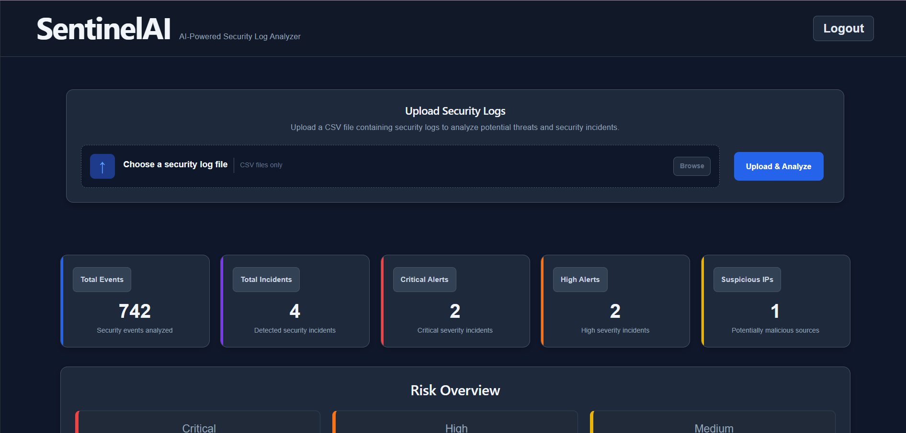
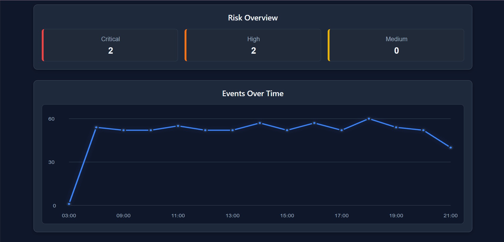
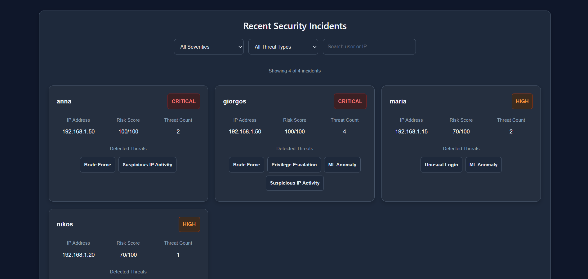
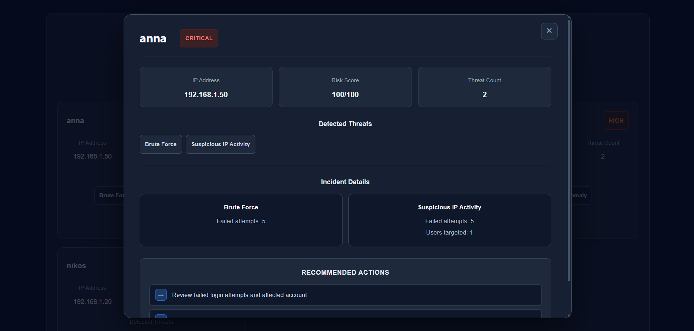

# SentinelAI

**AI-Powered Security Log Analyzer**

SentinelAI is a full-stack security monitoring application that analyzes security logs, detects suspicious activity, correlates related alerts into security incidents, calculates risk scores, and provides recommended investigation actions.

The project combines rule-based security detection with machine-learning anomaly detection using **Isolation Forest**, while providing authenticated access through **JWT-based authentication**.

## Live Demo

- **Application:** https://sentinelai-frontend-gosg.onrender.com
- **API Documentation:** https://sentinelai-api-usc3.onrender.com/docs

## Features

### Security Log Analysis

SentinelAI detects several types of suspicious activity:

* Brute Force
* Unusual Login
* Privilege Escalation
* Suspicious IP Activity
* Machine-Learning Anomalies

Detected alerts are correlated into security incidents based on **user + IP address**.

### Risk Scoring

Each incident receives a risk score from **0 to 100**.

The score takes into account:

* severity of detected threats
* multiple simultaneous threats
* dangerous threat combinations
* machine-learning anomaly evidence

Incidents are classified as:

* **LOW**
* **MEDIUM**
* **HIGH**
* **CRITICAL**

### Machine Learning

SentinelAI uses **Isolation Forest** to identify unusual behavior across user/IP profiles.

The model analyzes features including:

* total events
* failed login attempts
* successful logins
* failed login rate
* privilege changes
* password changes
* login activity during unusual hours
* number of unique IP addresses

Machine-learning anomalies are used as **supporting evidence** alongside rule-based detections rather than replacing them.

### Authentication

The application includes:

* User registration
* User login
* Argon2 password hashing
* JWT authentication
* Protected API endpoints
* JWT expiration
* Automatic logout after 30 minutes of inactivity
* Login rate limiting

### Security

The application also includes:

* Server-side input validation
* CSV input validation
* Parameterized PostgreSQL queries
* XSS-safe React rendering
* Security headers
* Content Security Policy
* Docker-based deployment
* OWASP ZAP security testing

## Technology Stack

### Frontend

* React
* Vite
* JavaScript
* CSS
* Nginx

### Backend

* Python
* FastAPI
* Pydantic
* PyJWT
* pwdlib / Argon2
* scikit-learn

### Database

* PostgreSQL 17
* psycopg

### Infrastructure

* Docker
* Docker Compose
* Nginx

### Security Testing

* OWASP ZAP

## Architecture

```text
                    ┌──────────────────────┐
                    │      React UI        │
                    │      + Vite          │
                    └──────────┬───────────┘
                               │
                         HTTP / JWT
                               │
                               ▼
                    ┌──────────────────────┐
                    │      FastAPI         │
                    │      Backend         │
                    └──────────┬───────────┘
                               │
             ┌─────────────────┼─────────────────┐
             │                 │                 │
             ▼                 ▼                 ▼
       Authentication     Log Analysis       PostgreSQL
        JWT + Argon2      Rules + ML
                               │
                               ▼
                     ┌──────────────────┐
                     │ Incident & Risk  │
                     │     Scoring      │
                     └──────────────────┘
```

## Detection Pipeline

```text
Security Logs
     │
     ▼
Input Validation
     │
     ▼
Rule-Based Detection
     │
     ├── Brute Force
     ├── Unusual Login
     ├── Privilege Escalation
     └── Suspicious IP
     │
     ├──────────────────────┐
     │                      │
     ▼                      ▼
Incident Correlation   Isolation Forest
     │                Anomaly Detection
     └───────────┬──────────┘
                 ▼
         Risk Score Calculation
                 │
                 ▼
        Recommended Actions
```

## Screenshots

### Authentication



### Dashboard



### Risk Overview & Events Over Time



### Security Incidents



### Incident Details



## Security

### Input Validation

Server-side validation is applied to registration, login inputs, and uploaded CSV files.

CSV validation includes:

* CSV file extension validation
* 5 MB file size limit
* required column validation
* field count validation
* timestamp validation
* username validation
* IP address validation
* event allowlisting
* status allowlisting

### SQL Injection Protection

Database operations use parameterized SQL queries through `psycopg`.

User-controlled values are not concatenated directly into SQL statements.

### XSS Protection

The React frontend renders user-controlled data through normal JSX rendering and does not use unsafe HTML insertion mechanisms such as `dangerouslySetInnerHTML`.

### Authentication Security

Passwords are hashed with **Argon2**.

JWT tokens:

* are signed with a server-side secret
* contain an expiration time
* are rejected when invalid or expired

Login requests are rate-limited to reduce brute-force and credential-stuffing attempts.

### Security Headers

The Nginx frontend configuration includes:

* `X-Content-Type-Options`
* `X-Frame-Options`
* `Referrer-Policy`
* `Permissions-Policy`
* `Content-Security-Policy`

## Security Testing

Security testing was performed using **OWASP ZAP**.

### Frontend Baseline Scan

Final scan result:

```text
FAIL: 0
WARN: 3
PASS: 64
```

The remaining findings were related to static-content cacheability, modern web application detection, and optional Cross-Origin-Embedder-Policy hardening.

### API Active Scan

Final result:

```text
FAIL: 0
WARN: 0
INFO: 0
PASS: 118
```

The API scan included checks for vulnerabilities such as:

* SQL Injection
* PostgreSQL time-based SQL Injection
* Reflected XSS
* Persistent XSS
* DOM-based XSS
* Path Traversal
* Command Injection
* Parameter Tampering
* XML External Entity attacks
* Server-Side Template Injection

Manual security testing was also performed for SQL injection, XSS, authentication behavior, and login rate limiting.

## PostgreSQL Database

The PostgreSQL container creates the `sentinelai` database and initializes three tables:

* `security_logs`
* `uploaded_security_logs`
* `users`

The backend connects to PostgreSQL internally through:

```text
postgres:5432
```

For local access from the host machine, PostgreSQL is exposed on:

```text
localhost:5433
```

PostgreSQL data is stored in a persistent Docker named volume:

```text
postgres_data
```

This keeps database records such as users and uploaded security logs available after a normal:

```bash
docker compose down
```

and subsequent restart.

> Do not use `docker compose down -v` unless you intentionally want to delete the PostgreSQL volume and reset the database.

## Project Structure

```text
SentinelAI/
│
├── backend/
│   ├── Dockerfile
│   ├── analyzer.py
│   ├── auth.py
│   ├── database.py
│   ├── main.py
│   └── requirements.txt
│
├── docker/
│   └── postgres/
│       ├── init.sql
│       └── seed.py
│
├── docs/
│   ├── login.png
│   ├── dashboard.png
│   ├── risk-overview.png
│   ├── security-incidents.png
│   └── incident-details.png
│
├── frontend/
│   ├── public/
│   ├── src/
│   │   ├── App.jsx
│   │   ├── App.css
│   │   ├── Login.css
│   │   ├── index.css
│   │   └── main.jsx
│   ├── .gitignore
│   ├── .oxlintrc.json
│   ├── Dockerfile
│   ├── nginx.conf
│   ├── index.html
│   ├── package.json
│   ├── package-lock.json
│   └── vite.config.js
│
├── scripts/
│   ├── generate_logs.py
│   └── failed_logins.py
│
├── .dockerignore
├── .gitignore
├── docker-compose.yml
├── README.md
└── security_logs.csv
```

## Running the Project

### Prerequisites

* Docker
* Docker Compose

### 1. Clone the repository

```bash
git clone <repository-url>
cd SentinelAI
```

### 2. Create the environment file

Create a `.env` file in the project root.

Example:

```env
POSTGRES_PASSWORD=<strong-database-password>
SECRET_KEY=<strong-random-jwt-secret>
```

The `.env` file must **not** be committed to the repository.

### 3. Start the application

```bash
docker compose up -d
```

Docker Compose starts:

* PostgreSQL
* FastAPI backend
* React frontend
* database seeding service

### 4. Open the application

Frontend: http://localhost:3000

Backend: http://localhost:8000

FastAPI Swagger documentation: http://localhost:8000/docs

### 5. Stop the application

```bash
docker compose down
```

## Example Workflow

1. Register a new account.
2. Log in to SentinelAI.
3. Upload a security log CSV.
4. The backend validates the uploaded data.
5. Detection rules identify suspicious activity.
6. Isolation Forest identifies anomalous behavior.
7. Related alerts are correlated into incidents.
8. Each incident receives a risk score and severity.
9. Recommended investigation actions are displayed in the dashboard.

During the active browser session, the dashboard preserves the results of the most recently uploaded CSV across page refreshes. Logging out clears the uploaded dashboard state, allowing the next login to start again from the default dataset.

## Future Improvements

Possible future extensions include:

* richer incident investigation workflows
* persistent audit logging
* improved anomaly explanations
* additional visual analytics
* role-based access control
* production HTTPS deployment
* centralized rate limiting with Redis
* production-oriented session/token storage

## Purpose

SentinelAI was developed as a portfolio project to demonstrate practical skills in:

* Full-stack development
* Backend API development
* PostgreSQL integration
* Authentication and secure access control
* Secure input handling
* Security engineering principles
* Machine-learning anomaly detection
* Docker-based application architecture
* Automated security testing
